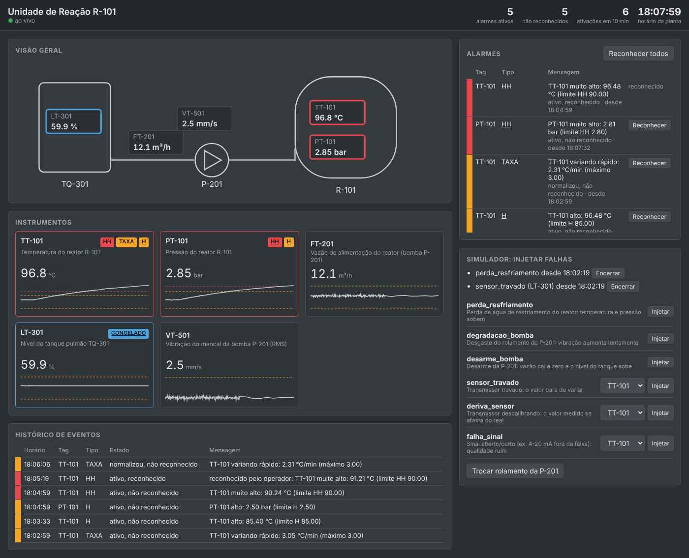
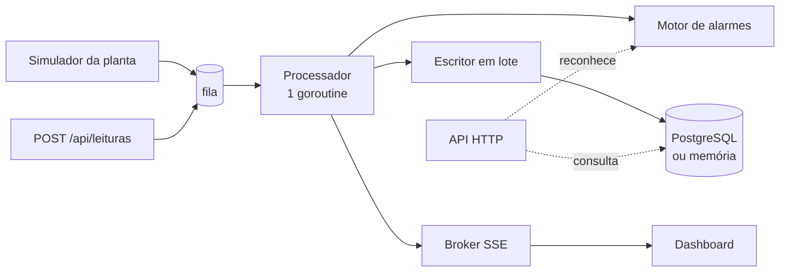

# Monitor de Processo Industrial

Sistema de monitoramento e **gestão de alarmes** para uma unidade de processo simulada, escrito em **Go**. Um simulador gera as leituras dos instrumentos, um motor avalia as regras de alarme em tempo real, o histórico vai para o **PostgreSQL** e um dashboard web mostra tudo ao vivo por **Server-Sent Events**. Também dá para injetar falhas (perda de resfriamento, desarme de bomba, sensor travado…) e ver como o sistema reage.

Trabalhei seis anos como operador de processos na indústria química e convivi com o principal problema desses sistemas: **alarme demais**. Quando tudo apita, o operador para de prestar atenção. Este projeto é a minha versão de como um sistema de alarmes deveria se comportar, seguindo as boas práticas da área (ISA-18.2, EEMUA 191 e ISA-101).



*Perda de resfriamento no reator: a temperatura sobe, a pressão acompanha e os alarmes aparecem em ordem de prioridade. O LT-301 está com o transmissor travado (alarme de diagnóstico, em azul).*

## O que o projeto demonstra

- **Go concorrente**: pipeline com goroutines e canais, fila com backpressure, gravação em lote fora do caminho crítico e encerramento gracioso que não perde dados (`go test -race` em tudo).
- **Regras de alarme de verdade**: banda morta (histerese), atraso de ativação, taxa de variação, detecção de sensor travado, supressão por qualidade ruim e uma **carta de controle EWMA** que avisa sobre desgaste da bomba **mais de 1 hora antes** do alarme de vibração alta.
- **Ciclo de vida ISA-18.2**: ativo/normalizado × reconhecido/não reconhecido, com histórico auditável.
- **API HTTP** com validação, códigos de status corretos, stream SSE e métricas Prometheus, só com a biblioteca padrão (o único pacote externo é o driver `pgx`).

## Arquitetura



- **Um único processador** garante que as leituras de cada tag sejam avaliadas na ordem em que chegaram, sem lock por tag.
- **O motor nunca espera o banco.** O escritor grava em lote a cada segundo. Se o banco cair, as leituras se acumulam até um limite e as mais antigas são descartadas (e contadas numa métrica). **Eventos de alarme nunca são descartados**, porque são o registro de auditoria.
- **Cliente lento não trava ninguém.** Cada conexão SSE tem seu próprio buffer; se ele encher, a mensagem é descartada só para aquele cliente.
- **Encerramento em ordem** (SIGTERM): o servidor para de aceitar requisições, o simulador para, o processador esvazia a fila e o escritor grava tudo que estava pendente antes de fechar o banco.

## A planta simulada

```
TQ-301 (LT-301) ──── P-201 (FT-201, VT-501) ────▶ R-101 (TT-101, PT-101)
tanque pulmão          bomba de alimentação          reator
```

| Tag | O que mede | Regras |
|---|---|---|
| TT-101 | Temperatura do reator (°C) | LL/L/H/HH, taxa de variação, congelado, EWMA |
| PT-101 | Pressão do reator (bar) | LL/L/H/HH, congelado |
| FT-201 | Vazão da bomba (m³/h) | LL/L/H/HH, taxa de variação, congelado |
| LT-301 | Nível do tanque (%) | LL/L/H/HH, congelado |
| VT-501 | Vibração do mancal da bomba (mm/s) | H/HH (valores típicos da ISO 10816), congelado, EWMA |

A configuração fica em [`config/tags.json`](config/tags.json) e é validada na inicialização (limites fora de ordem, faixa invertida e tags duplicados são rejeitados).

### Falhas que podem ser injetadas

| Falha | O que acontece | Alarmes esperados |
|---|---|---|
| `perda_resfriamento` | Temperatura sobe e, por consequência, a pressão | TT-101 TAXA → H → HH, depois PT-101 H → HH |
| `desarme_bomba` | Vazão cai a zero e o nível do tanque sobe | FT-201 TAXA, L, LL e depois LT-301 H |
| `degradacao_bomba` | Rolamento desgastando: vibração sobe 0,03 mm/s por minuto | VT-501 **DERIVA** cerca de 1 h antes do H |
| `sensor_travado` | Transmissor para de variar | CONGELADO |
| `deriva_sensor` | Transmissor descalibrando aos poucos | DERIVA (onde houver EWMA) |
| `falha_sinal` | Laço 4-20 mA aberto: valor fora da faixa | QUALIDADE (e nenhum alarme de processo falso) |

## Decisões sobre os alarmes

**Banda morta e atraso de ativação.** Um valor oscilando em cima do limite faria o alarme piscar dezenas de vezes. Para normalizar, o valor precisa voltar além da banda morta. Para disparar, a condição precisa durar o atraso configurado.

**Qualidade ruim suprime os alarmes de processo.** Se o transmissor de vazão perde o sinal, ele não pode disparar "vazão muito baixa". Isso mandaria o operador investigar um problema de processo que não existe. Só o alarme de qualidade do instrumento aparece.

**EWMA para pegar o problema antes do limite.** A carta de controle compara a média móvel exponencial com a referência aprendida nos primeiros 30 minutos. Ela detecta mudanças pequenas e persistentes que nunca chegariam aos limites H/L tão cedo, como o desgaste da bomba: o teste `TestEWMADetectaDesgasteDaBombaMuitoAntesDoLimite` verifica que o aviso vem pelo menos 45 minutos antes do alarme H (na prática, cerca de 1 h 06 min).

**Medir alarmes falsos em vez de supor.** Rodei 40 simulações de 12 horas sem nenhuma falha. Mesmo depois de aumentar o período de aprendizado da referência, 13 delas ainda geravam alarmes de deriva falsos, porque flutuações aleatórias às vezes passam do limite por alguns segundos. Exigir que a média móvel fique fora por 3 minutos (`confirmacao`) zerou os falsos (0 de 40), mesmo com limites mais sensíveis (4σ em vez de 4,5σ), e atrasa a detecção real em só 3 minutos. O teste `TestOperacaoNormalNaoGeraAlarmes` garante 6 horas de operação normal sem nenhum alarme.

**Inundação de alarmes.** O dashboard mostra quantos alarmes dispararam nos últimos 10 minutos e destaca quando passa de 10, o critério da EEMUA 191 para "inundação".

**Tela em cinza.** Seguindo a ISA-101, a tela é neutra e a cor aparece só quando algo está anormal: vermelho para prioridade alta, âmbar para média e azul para diagnóstico. Alarme não reconhecido pisca.

## Como rodar

Requisitos: Go 1.24+ (ou só Docker).

**Primeiro uso:** gere o `go.sum` (baixa o driver do PostgreSQL) e faça commit dele.

```bash
go mod tidy
```

**Sem banco (histórico em memória):**

```bash
make rodar            # tempo real
make rodar-rapido     # 30 s de planta por segundo
# abra http://localhost:8080
```

**Com PostgreSQL via Docker:**

```bash
make docker           # ou: docker compose up --build
SIM_VELOCIDADE=30 docker compose up --build
```

| Variável | Padrão | Descrição |
|---|---|---|
| `HTTP_ENDERECO` | `:8080` | Endereço do servidor |
| `DATABASE_URL` | vazio | PostgreSQL; vazio = memória |
| `TAGS_ARQUIVO` | embutido | JSON com os tags |
| `SIMULADOR` | `true` | Desligue para receber leituras só pela API |
| `SIM_VELOCIDADE` | `1` | Segundos simulados por segundo real (1 a 600) |
| `SIM_SEMENTE` | aleatória | Semente para reproduzir uma simulação |
| `LOG_NIVEL` | `info` | `debug`, `info`, `warn`, `error` |

## API

| Método | Caminho | Descrição |
|---|---|---|
| GET | `/api/tags` | Tags com última leitura e alarmes ativos |
| GET | `/api/tags/{id}/leituras?minutos=30&limite=2000` | Histórico do tag |
| POST | `/api/leituras` | Ingestão de leituras externas (até 5000 por requisição) |
| GET | `/api/alarmes` | Alarmes ativos e indicador de inundação |
| GET | `/api/alarmes/historico?tag=&limite=100` | Eventos de alarme |
| POST | `/api/alarmes/{tag}/{tipo}/reconhecer` | Reconhece um alarme (409 se não houver o que reconhecer) |
| POST | `/api/alarmes/reconhecer-todos` | Reconhece todos |
| GET / POST | `/api/simulador/falhas` | Lista ou injeta falhas |
| DELETE | `/api/simulador/falhas/{tipo}?tag=` | Encerra uma falha |
| GET | `/api/stream` | Server-Sent Events (`leituras` e `alarmes`) |
| GET | `/metrics` | Métricas no formato Prometheus |
| GET | `/healthz`, `/readyz` | Liveness e readiness (testa o banco) |

Exemplo de ingestão:

```bash
curl -X POST localhost:8080/api/leituras -H 'Content-Type: application/json' \
  -d '[{"tag":"TT-101","momento":"2026-01-01T12:00:00Z","valor":86.4}]'
# 202 {"aceitas":1}   400 JSON inválido   422 tag/valor inválido   503 fila cheia (Retry-After)
```

## Testes

```bash
make testes       # unitários e de API, com -race
make integracao   # repositório PostgreSQL contra um banco real
```

Os testes do simulador rodam horas de planta em segundos e verificam a física dos cenários: a perda de resfriamento precisa disparar a temperatura antes da pressão, o desarme da bomba precisa levar ao nível alto, e um sinal ruim não pode gerar alarme de processo. A CI roda tudo isso, além dos testes de integração com um PostgreSQL de verdade e o build da imagem Docker.

## Estrutura

```
cmd/monitor/                 main: configuração, conexão com o banco e shutdown
config/tags.json             configuração dos instrumentos (embutida no binário)
internal/processo/           tipos do domínio e validação da configuração
internal/simulador/          modelo da planta e injeção de falhas
internal/alarmes/            motor de alarmes e máquina de estados
internal/armazenamento/      interface, memória, escritor em lote e PostgreSQL
internal/transmissao/        broker SSE
internal/app/                pipeline (simulador → motor → gravação/stream)
internal/api/                handlers HTTP, métricas e dashboard (web/)
```

## Limitações e próximos passos

- O histórico usa PostgreSQL puro com índice BRIN. Para volumes grandes, o próximo passo seria **TimescaleDB** (particionamento e compressão automáticos).
- O estado dos alarmes fica em memória: num restart, alarmes ativos reaparecem como novos. Persistir o estado atual resolveria.
- Faltam recursos de gestão de alarmes como **shelving** (silenciar temporariamente com motivo) e supressão por estado do equipamento (ex.: não alarmar vibração com a bomba parada).
- Autenticação nos endpoints de reconhecimento e de injeção de falhas.
- Painel no Grafana a partir do `/metrics`.
